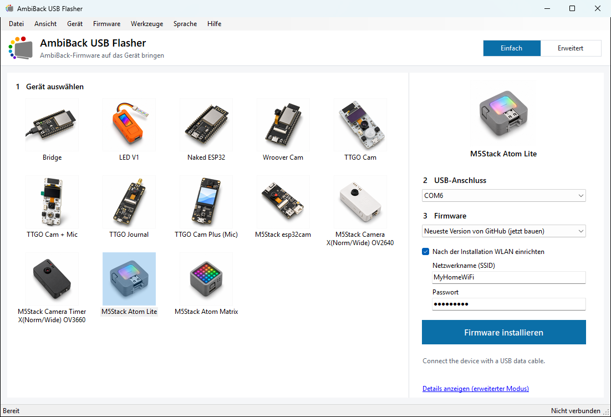

# AmbiBack USB Flasher

[English](README.md) · **Deutsch**

Windows-Werkzeug, das die AmbiBack-Firmware per USB auf ESP32-basierte AmbiBack-Geräte bringt: Gerät wählen, anschließen, **Firmware installieren** klicken. Außerdem richtet es das WLAN des Geräts ein, zeigt seine serielle Ausgabe und steuert es.

Es gehört zum [AmbiBack-Projekt](https://github.com/ambiback) und arbeitet mit der [AmbiBack-Firmware](https://github.com/ambiback/ambiback-firmware).

## Status

- Dies ist ein internes Entwicklungswerkzeug, das unverändert im Funktionsumfang veröffentlicht wird. Mit Ecken und Kanten ist zu rechnen.
- Der Release-Build dieses Repositorys läuft durch.
- **Das migrierte Werkzeug wurde weder gestartet noch mit echter Hardware getestet.**
- AmbiBack-Geräte werden seit rund fünf Jahren nicht mehr verkauft. Dieses Repository ist für Eigenbau und Weiterentwicklung gedacht, ohne Produktsupport. Mehr auf [ambiback.de](https://www.ambiback.de/).

## Schnellstart

1. Setup oder portable ZIP von der [Release-Seite](https://github.com/ambiback/ambiback-flasher/releases) laden und den Flasher starten. (Noch kein Release? Selbst bauen, siehe [Entwicklerhandbuch](docs/developer.de.md).)
2. Auf das Bild des eigenen Geräts klicken.
3. Gerät mit einem USB-**Daten**kabel anschließen. Der Flasher wählt den Anschluss selbst.
4. **Neueste Version von GitHub (jetzt bauen)** ausgewählt lassen. Optional: **Nach der Installation WLAN einrichten** anhaken und Name und Passwort des 2,4-GHz-Netzes eingeben.
5. **Firmware installieren** klicken und auf **Fertig** warten. Beim ersten Mal werden die Werkzeuge geladen und eingerichtet; das dauert einige Minuten und braucht etwa 1 GB Speicherplatz.

Kein USB-Anschluss zu sehen oder die Installation schlägt fehl? Siehe [Fehlerbehebung](docs/troubleshooting.de.md).

## Dokumentation

| Anleitung | Inhalt |
|---|---|
| [Benutzerhandbuch](docs/user-guide.de.md) | Installation, einfacher Modus, WLAN-Einrichtung, erweiterter Modus, serieller Monitor und Gerätesteuerung, Werkzeug-Einrichtung, Einstellungen |
| [Fehlerbehebung](docs/troubleshooting.de.md) | Kein USB-Anschluss, USB-Treiber (FTDI, CP210x, CH340/CH9102), Boot-Modus, Probleme beim Bauen und mit dem WLAN |
| [Entwicklerhandbuch](docs/developer.de.md) | Werkzeug bauen, Releases, Ordner und Downloads, Firmware-Upload auf einen eigenen Server |

## Funktionen

- **Einfacher Modus:** Gerät per Bild wählen, USB-Anschluss wählen und **Firmware installieren** drücken. Gibt es noch kein Image, lädt das Werkzeug alles Nötige, baut die neueste Firmware von GitHub und flasht sie. Das WLAN lässt sich direkt danach einrichten.
- **Erweiterter Modus:** Build-Optionen, Builder und ESP32-Core, serieller Monitor, Geräteinfo und -steuerung, Upload.
- Baut die Firmware für alle 13 AmbiBack-Gerätetypen mit `arduino-cli` (Standard) oder `arduino-builder` (Arduino IDE 1.8.x)
- **Werkzeuge > Arduino und ESP32 einrichten** lädt arduino-cli und/oder die Arduino IDE 1.8.x, einen ESP32-Core in der gewählten Version, die Firmware-Bibliotheken und den Firmware-Quellcode
- Flasht per USB mit `esptool`, mit Fortschrittsanzeige
- Gerätesteuerung: Info, Neustart, WLAN-Einrichtung, LED-Modi und -Test, Relay-ID, Werkseinstellungen
- Oberfläche auf Englisch und Deutsch (Menü **Sprache**)

## Lizenz

Copyright (C) 2020-2026 Andre Lorbach

Dieses Programm ist freie Software unter der [GNU General Public License Version 3](LICENSE). Es wird ohne jede Gewährleistung bereitgestellt. Drittcode behält seine eigene Lizenz, siehe [THIRD_PARTY_NOTICES.md](THIRD_PARTY_NOTICES.md).
