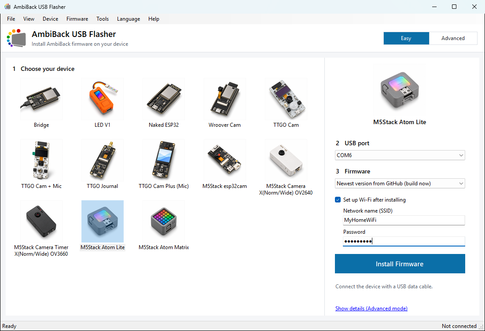

# AmbiBack USB Flasher

**English** · [Deutsch](README.de.md)

Windows tool that installs the AmbiBack firmware on ESP32-based AmbiBack devices over USB: pick the device, plug it in, click **Install Firmware**. It can also set up the device's Wi-Fi, show its serial output and control it.

It is part of the [AmbiBack project](https://github.com/ambiback) and works with the [AmbiBack firmware](https://github.com/ambiback/ambiback-firmware).

## Status

- This is an internal development tool published as is. Expect rough edges.
- The Release build of this repository passes.
- **The migrated tool has not been started or tested with real hardware.**
- AmbiBack devices have not been on sale for around five years. This repository is for DIY use and further development, with no product support. More at [ambiback.de](https://www.ambiback.de/).

## Quick start

1. Download the setup or the portable ZIP from the [Releases page](https://github.com/ambiback/ambiback-flasher/releases) and start the flasher. (No release yet? Build it yourself, see the [developer guide](docs/developer.md).)
2. Click the picture of your device.
3. Connect the device with a USB **data** cable. The flasher picks its port.
4. Leave **Newest version from GitHub (build now)** selected. Optional: tick **Set up Wi-Fi after installing** and enter your 2.4 GHz network name and password.
5. Click **Install Firmware** and wait for **Done**. The first time, the tools are downloaded and set up; this takes several minutes and needs about 1 GB of disk space.

No USB port shown, or installing fails? See [Troubleshooting](docs/troubleshooting.md).

## Documentation

| Guide | Contents |
|---|---|
| [User guide](docs/user-guide.md) | Installing, Easy mode, Wi-Fi setup, Advanced mode, serial monitor and device control, tool setup, settings |
| [Troubleshooting](docs/troubleshooting.md) | No USB port, USB drivers (FTDI, CP210x, CH340/CH9102), boot mode, build and Wi-Fi problems |
| [Developer guide](docs/developer.md) | Building the tool, releases, folders and downloads, firmware upload to your own server |

## Features

- **Easy mode:** pick the device from pictures, choose the USB port and press **Install Firmware**. If no image is there yet, the tool downloads everything it needs, builds the newest firmware from GitHub and flashes it. Wi-Fi can be set right after flashing.
- **Advanced mode:** build options, builder and ESP32 core, serial monitor, device info and control, upload.
- Builds firmware for all 13 AmbiBack device types with `arduino-cli` (default) or `arduino-builder` (Arduino IDE 1.8.x)
- **Tools > Set Up Arduino and ESP32** downloads arduino-cli and/or the Arduino IDE 1.8.x, an ESP32 core in the chosen version, the firmware libraries and the firmware source
- Flashes over USB with `esptool`, with progress
- Device control: info, restart, Wi-Fi setup, LED modes and test, relay ID, factory defaults
- English and German user interface (**Language** menu)

## License

Copyright (C) 2020-2026 Andre Lorbach

This program is free software under the [GNU General Public License version 3](LICENSE). It comes with no warranty. Third-party code keeps its own license, see [THIRD_PARTY_NOTICES.md](THIRD_PARTY_NOTICES.md).
