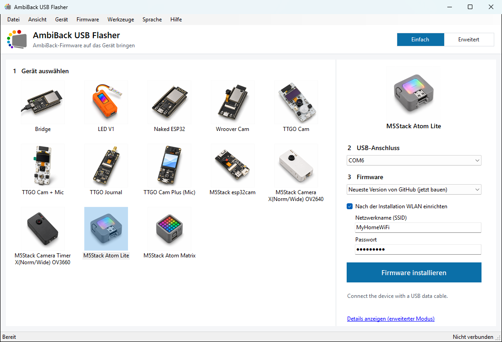
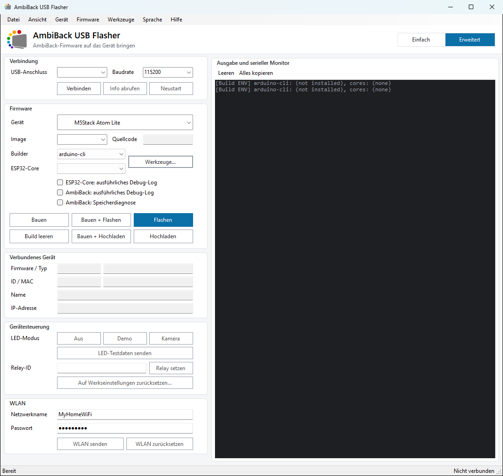
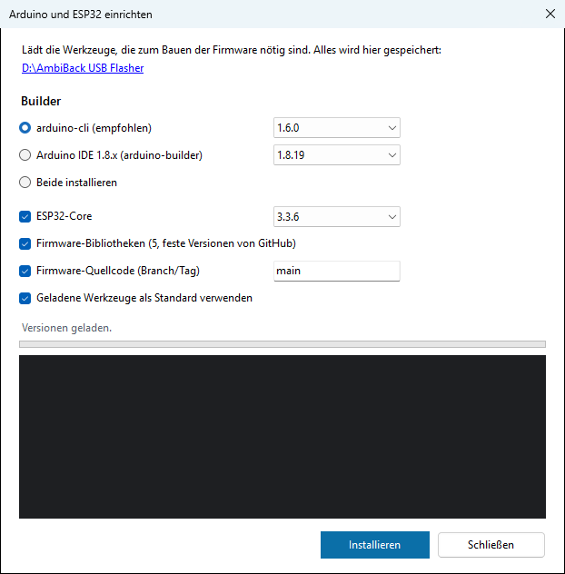

# AmbiBack USB Flasher – Benutzerhandbuch

[English](user-guide.md) · **Deutsch**

Dieses Handbuch erklärt, wie die AmbiBack-Firmware auf ein ESP32-basiertes AmbiBack-Gerät kommt und wie dessen WLAN eingerichtet wird. Probleme und Lösungen stehen in der [Fehlerbehebung](troubleshooting.de.md).

> **Status:** Das Werkzeug wurde seit der Migration nicht mit echter Hardware getestet. AmbiBack-Geräte werden seit rund fünf Jahren nicht mehr verkauft; dies ist ein Eigenbau-Projekt ohne Produktsupport. Siehe [Status](../README.de.md#status).

## Inhalt

1. [Was gebraucht wird](#was-gebraucht-wird)
2. [Flasher installieren](#flasher-installieren)
3. [Firmware installieren (einfacher Modus)](#firmware-installieren-einfacher-modus)
4. [WLAN einrichten](#wlan-einrichten)
5. [Erweiterter Modus](#erweiterter-modus)
6. [Serieller Monitor und Gerätesteuerung](#serieller-monitor-und-gerätesteuerung)
7. [Werkzeuge von Hand einrichten](#werkzeuge-von-hand-einrichten)
8. [Einstellungen, Datenordner und Sprache](#einstellungen-datenordner-und-sprache)
9. [Deinstallieren](#deinstallieren)

## Was gebraucht wird

- Ein PC mit Windows 10 oder 11 und Internetverbindung.
- Etwa **1 GB freier Speicherplatz**. Der erste Firmware-Build lädt arduino-cli, den ESP32-Core, die Firmware-Bibliotheken und den Firmware-Quellcode von GitHub (mehrere hundert MB).
- Ein AmbiBack-kompatibles ESP32-Gerät (siehe [Gerätetypen](#gerätetypen)).
- Ein **USB-Datenkabel**. Viele Kabel laden nur und übertragen keine Daten; mit so einem Kabel zeigt Windows keinen Anschluss.
- Eventuell einen USB-Treiber für den USB-Chip des Geräts (FTDI, Silicon Labs CP210x oder WCH CH340/CH9102). Siehe [USB-Treiber](troubleshooting.de.md#usb-treiber).

## Flasher installieren

Das neueste Release von der [Release-Seite](https://github.com/ambiback/ambiback-flasher/releases) laden. Es gibt zwei Dateien:

| Datei | Verwendung |
|---|---|
| `AmbiBack-USB-Flasher-<version>-setup.exe` | Setup auf Deutsch oder Englisch. Installiert ohne Administratorrechte für den aktuellen Benutzer oder wahlweise für alle Benutzer. Bietet die Installation des .NET Frameworks an, falls es fehlt. |
| `AmbiBack-USB-Flasher-<version>.zip` | Portable Version. In einen beschreibbaren Ordner entpacken und `AmbiBack USB Flasher.exe` starten. |

Die Dateien sind nicht signiert. Windows SmartScreen kann beim ersten Start warnen: **Weitere Informationen** und dann **Trotzdem ausführen** klicken.

Solange noch kein Release veröffentlicht ist, das Werkzeug selbst bauen, siehe [Entwicklerhandbuch](developer.de.md).

## Firmware installieren (einfacher Modus)

Der Flasher startet im **einfachen** Modus.

1. **Gerät auswählen.** Auf das Bild klicken, das zum Gerät passt. Im Zweifel die Platine mit den Bildern vergleichen und die [Gerätetypen](#gerätetypen) ansehen.
2. **Gerät anschließen**, mit einem USB-Datenkabel. Der Flasher wählt den Anschluss eines neu angeschlossenen Geräts selbst. Das Feld **USB-Anschluss** prüfen. Steht dort *Kein USB-Anschluss gefunden*, siehe [Kein USB-Anschluss](troubleshooting.de.md#kein-usb-anschluss-zu-sehen).
3. **Firmware wählen.**
   - **Neueste Version von GitHub (jetzt bauen)** lädt den neuesten Firmware-Quellcode und baut ihn für das Gerät. Beim ersten Mal werden vorher die Werkzeuge geladen; das dauert einige Minuten.
   - **Version x.y.z (bereit zur Installation)** installiert ein früher gebautes Image. Kein Download, kein Build.
4. Optional: **Nach der Installation WLAN einrichten** anhaken und Netzwerkname (SSID) und Passwort eingeben. Siehe [WLAN einrichten](#wlan-einrichten).
5. **Firmware installieren** klicken.

Der Text unter dem Button zeigt jeden Schritt: Werkzeuge einrichten, Quellcode laden, bauen, installieren. Das Gerät angeschlossen lassen, bis **Fertig. Firmware x.y.z ist installiert.** erscheint. Hat das Gerät eine IP-Adresse gemeldet, steht sie dort ebenfalls.

Schlägt etwas fehl, sagt die Meldung, was zu prüfen ist. **Details anzeigen (erweiterter Modus)** zeigt das vollständige Log.

### Gerätetypen

| Beschriftung am Bild | Gerätetyp | Hinweis |
|---|---|---|
| Bridge | `bridge` | Allgemeines ESP32-Board als AmbiBack Bridge |
| LED V1 | `ambiledv1` | AmbiBack LED-Controller V1 |
| Naked ESP32 | `naked` | Allgemeines ESP32-Board |
| Wroover Cam | `wroover` | ESP32-WROVER-Kamera-Board |
| TTGO Cam | `ttgo` | LilyGO TTGO T-Camera |
| TTGO Cam + Mic | `ttgotm` | LilyGO TTGO T-Camera mit Mikrofon |
| TTGO Journal | `ttgojr` | LilyGO TTGO T-Journal |
| TTGO Cam Plus (Mic) | `ttgopl` | LilyGO TTGO T-Camera Plus |
| M5Stack esp32cam | `m5esp32` | M5Stack ESP32CAM |
| M5Stack Camera X (Norm/Wide) OV2640 | `m5camx` | M5Stack Camera X mit OV2640-Sensor |
| M5Stack Camera Timer X (Norm/Wide) OV3660 | `m5camtx` | M5Stack Timer Camera X mit OV3660-Sensor |
| M5Stack Atom Lite | `m5alit` | M5Stack Atom Lite |
| M5Stack Atom Matrix | `m5almx` | M5Stack Atom Matrix |

Der Gerätetyp ist auch der Name der Ordner mit den gebauten Images (`firmware\<gerätetyp>\<version>\`).

## WLAN einrichten

AmbiBack-Geräte verbinden sich mit einem **2,4-GHz**-WLAN. ESP32-Chips können keine 5-GHz-Netze nutzen.

**Beim Installieren (einfacher Modus):** **Nach der Installation WLAN einrichten** anhaken und Netzwerkname und Passwort eingeben. Nach dem Flashen wartet der Flasher einige Sekunden, bis das Gerät gestartet ist, sendet die WLAN-Daten über USB und fragt die Geräteinfo ab.

**Später (erweiterter Modus):**

1. Zu **Erweitert** wechseln und den **USB-Anschluss** des Geräts wählen.
2. **Verbinden** klicken. Der Flasher öffnet die serielle Verbindung und fragt die Geräteinfo ab.
3. Im Bereich **WLAN** Netzwerkname und Passwort eingeben und **WLAN senden** klicken.
4. Nach einigen Sekunden **Info abrufen** klicken. Das Feld **IP-Adresse** zeigt die Adresse im eigenen Netz.

**WLAN zurücksetzen** löscht die gespeicherten WLAN-Daten auf dem Gerät.

Die Daten gehen nur über das USB-Kabel. Geräte mit WLAN-Access-Point lassen sich auch ohne Flasher mit dem AmbiBack Manager einrichten; siehe [Firmware-README](https://github.com/ambiback/ambiback-firmware/blob/main/README.de.md).

## Erweiterter Modus

Oben rechts auf **Erweitert** klicken (oder **Ansicht > Erweiterter Modus**), um alle Optionen zu sehen.

**Verbindung**

- **USB-Anschluss** und **Baudrate** für den seriellen Monitor. 115200 ist die normale Rate der Firmware.
- **Verbinden / Trennen**, **Info abrufen**, **Neustart**.

**Firmware**

- **Gerät:** der Gerätetyp, wie das Bild im einfachen Modus.
- **Image:** ein gebautes Image im Firmware-Ordner. **Flashen** installiert dieses.
- **Quellcode:** die Firmware-Version im geladenen Quellcode.
- **Builder:** `arduino-cli` (empfohlen) oder `arduino-builder` (braucht die Arduino IDE 1.8.x).
- **ESP32-Core:** die installierte ESP32-Core-Version, mit der gebaut wird.
- **Werkzeuge...** öffnet den Einrichtungsdialog, siehe [Werkzeuge von Hand einrichten](#werkzeuge-von-hand-einrichten).
- Debug-Optionen: ausführliches Log des ESP32-Cores, ausführliches AmbiBack-Log, Speicherdiagnose. Nur zur Fehlersuche verwenden; sie machen die Firmware langsamer und das Log länger.

| Button | Wirkung |
|---|---|
| **Bauen** | Baut die Firmware für das gewählte Gerät und legt das Image in `firmware\<gerät>\<version>\` ab |
| **Bauen + Flashen** | Baut und installiert danach auf dem Gerät |
| **Flashen** | Installiert das gewählte Image |
| **Build leeren** | Löscht die Build-Ordner des gewählten Geräts. Hilft, wenn ein Build sich seltsam verhält |
| **Bauen + Hochladen**, **Hochladen** | Upload auf einen eigenen Update-Server; für Entwickler, siehe [Entwicklerhandbuch](developer.de.md#firmware-hochladen) |

Das Menü **Firmware** enthält dieselben Befehle. Die Ausgabe rechts zeigt das Log von Build, Flashen und serieller Schnittstelle. **Alles kopieren** kopiert es, etwa für eine Fehlermeldung.

## Serieller Monitor und Gerätesteuerung

Nach **Verbinden** zeigt das Ausgabefenster alles, was das Gerät auf die serielle Schnittstelle schreibt. Der Bereich **Verbundenes Gerät** zeigt Firmware-Version und -Typ, Geräte-ID, MAC-Adresse, Name und IP-Adresse.

**Gerätesteuerung** (auch im Menü **Gerät**):

- **LED-Modus:** **Aus**, **Demo** (Testmuster) oder **Kamera** (normaler Betrieb von Kamera-Geräten).
- **LED-Testdaten senden:** sendet ein Bild mit Testfarben.
- **Relay-ID / Relay setzen:** für Kamera-Geräte. Legt die ID des AmbiBack-Controllers fest, an den die Kamera ihre Farben über das Netz sendet (Relay-Modus). Beim Verbinden eines LED- oder PC-Controllers trägt **Info abrufen** dessen MAC-Adresse ein; diese notieren, die Kamera verbinden und **Relay setzen** klicken.
- **Auf Werkseinstellungen zurücksetzen...:** löscht alle Einstellungen auf dem Gerät, auch das WLAN. Das lässt sich nicht rückgängig machen; der Flasher fragt vorher nach.

Die Verbindung mit **Trennen** schließen, bevor ein anderes Programm den Anschluss nutzt. Vor dem Flashen schließt der Flasher sie selbst.

## Werkzeuge von Hand einrichten

Der einfache Modus richtet alles Nötige selbst ein. Um Versionen selbst zu wählen, **Werkzeuge > Arduino und ESP32 einrichten...** öffnen (oder **Werkzeuge...** im erweiterten Modus).

- **Builder:** arduino-cli (empfohlen), die Arduino IDE 1.8.x mit arduino-builder oder beide, jeweils in der gewählten Version.
- **ESP32-Core:** die Core-Version, standardmäßig 3.3.6.
- **Firmware-Bibliotheken:** die Bibliotheken, die die Firmware braucht, in festen Versionen von GitHub.
- **Firmware-Quellcode (Branch/Tag):** `main` für den neuesten Quellcode oder ein Tag eines Firmware-Releases.
- **Geladene Werkzeuge als Standard verwenden:** macht die neuen Versionen zur Auswahl im erweiterten Modus.

**Installieren** klicken. Das Log unten zeigt den Fortschritt. Die Versionslisten kommen von GitHub; ohne Internetverbindung werden die bekannten Versionen angezeigt.

**Werkzeuge > Firmware-Quellcode von GitHub laden** aktualisiert nur den Firmware-Quellcode.

## Einstellungen, Datenordner und Sprache

Alles, was der Flasher lädt oder baut, liegt in einem **Datenordner**:

- im Programmordner, wenn Windows dort Schreibzugriff erlaubt (portable Version oder Setup für den aktuellen Benutzer), sonst
- in `%LOCALAPPDATA%\AmbiBack\USB Flasher` (Setup für alle Benutzer).

**Datei > Datenordner öffnen** öffnet ihn, **Datei > Firmware-Ordner öffnen** die gebauten Images. **Hilfe > Über** zeigt den Pfad.

**Datei > Einstellungen...** (Strg+,) ändert die Ordner: Arduino IDE 1.8.x, Firmware-Quellcode, Sketch-Datei, Bibliotheken, Datenordner und Build-Ordner. Ein leeres Feld verwendet den grau angezeigten Standard. **Standardwerte** leert alle Felder.

Für ein eigenes Gerätebild eine PNG-Datei mit dem Namen des Gerätetyps in den Ordner `devices` des Datenordners legen, zum Beispiel `devices\m5alit.png`.

**Sprache** wechselt zwischen Deutsch und Englisch. Ohne Auswahl folgt der Flasher der Anzeigesprache von Windows.

## Deinstallieren

Den Flasher in den Windows-**Einstellungen > Apps > Installierte Apps** entfernen. Das Deinstallationsprogramm fragt, ob auch die geladenen Werkzeuge, der Firmware-Quellcode, die gebauten Images und die Einstellungen gelöscht werden sollen. Bei der portablen Version deren Ordner löschen.
