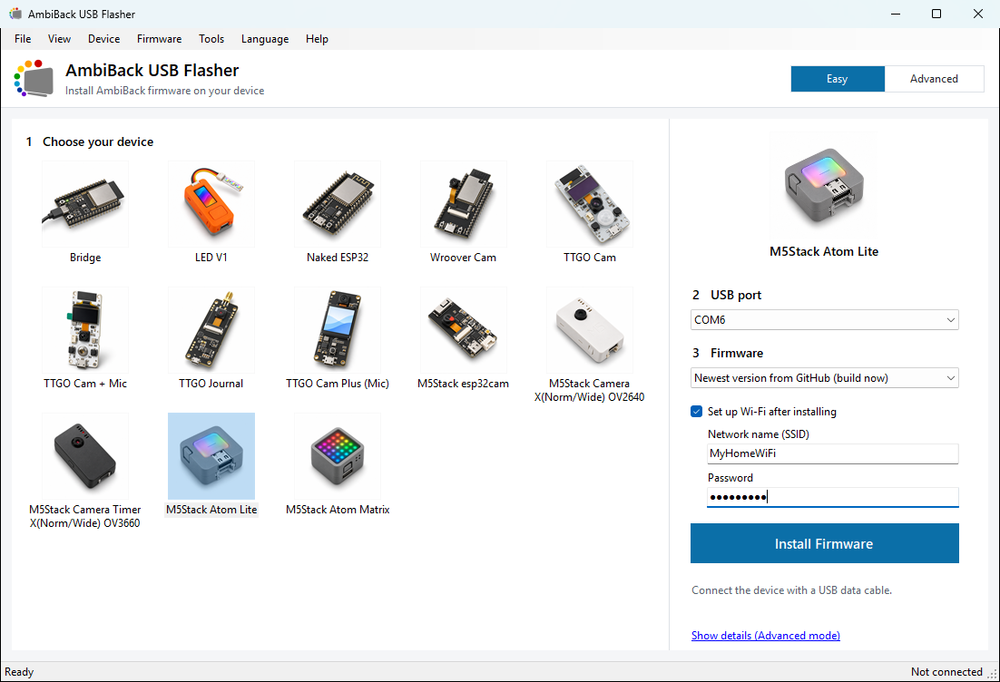
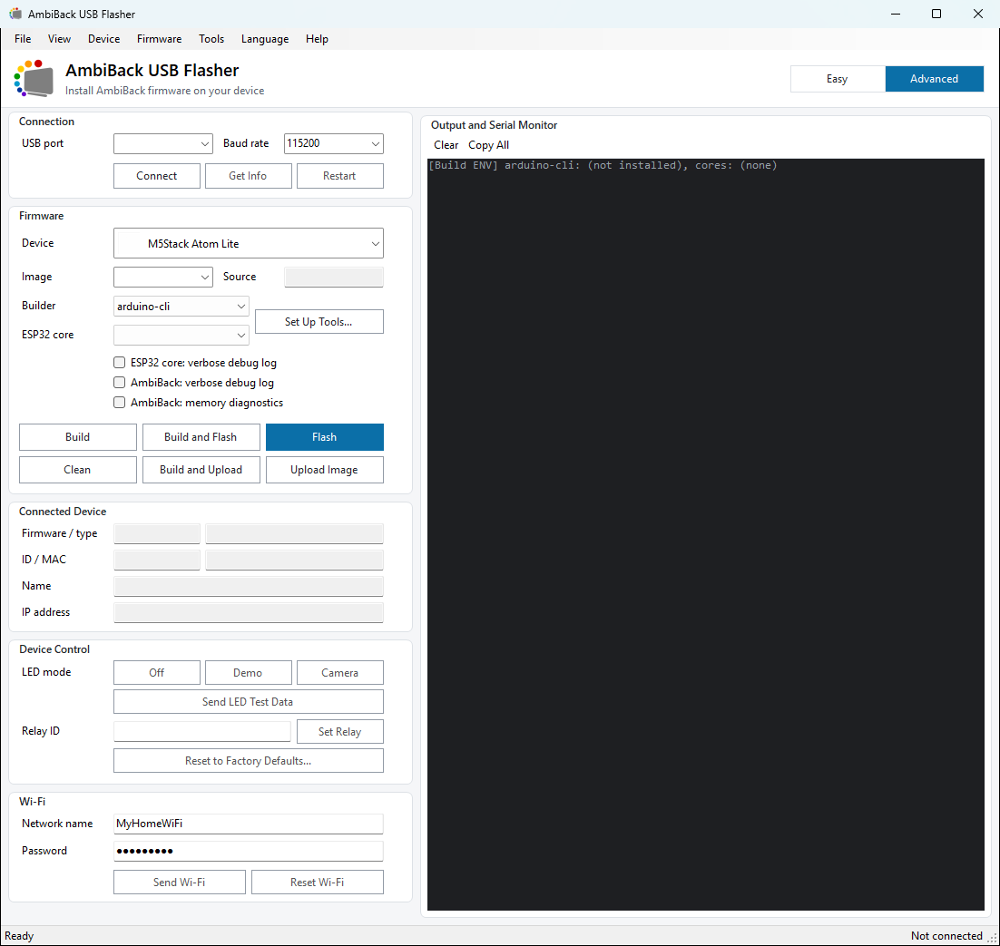
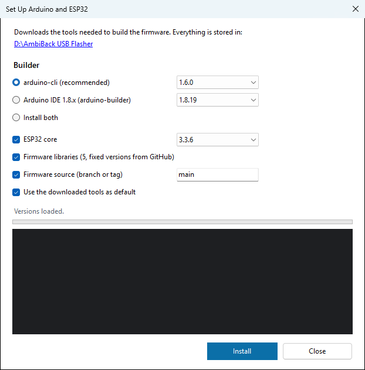

# AmbiBack USB Flasher – User Guide

**English** · [Deutsch](user-guide.de.md)

This guide explains how to install the AmbiBack firmware on an ESP32-based AmbiBack device and how to set up its Wi-Fi. Problems and their fixes are in [Troubleshooting](troubleshooting.md).

> **Status:** the tool has not been tested with real hardware since its migration. AmbiBack devices have not been on sale for around five years; this is a DIY project without product support. See [Status](../README.md#status).

## Contents

1. [What you need](#what-you-need)
2. [Install the flasher](#install-the-flasher)
3. [Install the firmware (Easy mode)](#install-the-firmware-easy-mode)
4. [Set up Wi-Fi](#set-up-wi-fi)
5. [Advanced mode](#advanced-mode)
6. [Serial monitor and device control](#serial-monitor-and-device-control)
7. [Set up the tools by hand](#set-up-the-tools-by-hand)
8. [Settings, data folder and language](#settings-data-folder-and-language)
9. [Uninstall](#uninstall)

## What you need

- A Windows 10 or 11 PC with an internet connection.
- About **1 GB of free disk space**. The first firmware build downloads arduino-cli, the ESP32 core, the firmware libraries and the firmware source from GitHub (several hundred MB).
- An AmbiBack-compatible ESP32 device (see [Device types](#device-types)).
- A **USB data cable**. Many cables only charge and carry no data; with such a cable Windows shows no port.
- Possibly a USB driver for the device's USB chip (FTDI, Silicon Labs CP210x or WCH CH340/CH9102). See [USB drivers](troubleshooting.md#usb-drivers).

## Install the flasher

Download the newest release from the [Releases page](https://github.com/ambiback/ambiback-flasher/releases). There are two files:

| File | Use |
|---|---|
| `AmbiBack-USB-Flasher-<version>-setup.exe` | Setup in English or German. Installs for the current user without administrator rights, or for all users. Offers to install the .NET Framework if it is missing. |
| `AmbiBack-USB-Flasher-<version>.zip` | Portable version. Unpack it into a folder you can write to and start `AmbiBack USB Flasher.exe`. |

The files are not code-signed. Windows SmartScreen may warn on the first start: click **More info**, then **Run anyway**.

Until the first release is published, build the tool yourself, see the [developer guide](developer.md).

## Install the firmware (Easy mode)

The flasher starts in **Easy** mode.

1. **Choose your device.** Click the picture that matches your device. If you are not sure, compare the board with the pictures and see [Device types](#device-types).
2. **Connect the device** with a USB data cable. The flasher picks the port of a newly connected device by itself. Check the **USB port** field. If it says *No USB port found*, see [No USB port](troubleshooting.md#no-usb-port-is-shown).
3. **Choose the firmware.**
   - **Newest version from GitHub (build now)** downloads the newest firmware source and builds it for your device. The first time, the tools are downloaded first; this takes several minutes.
   - **Version x.y.z (ready to install)** installs an image that was built before. No download, no build.
4. Optional: tick **Set up Wi-Fi after installing** and enter the network name (SSID) and password. See [Set up Wi-Fi](#set-up-wi-fi).
5. Click **Install Firmware**.

The text under the button shows each step: setting up tools, downloading the source, building, installing. Keep the device connected until it says **Done. Firmware x.y.z is installed.** If the device reported an IP address, it is shown there as well.

If something fails, the message tells you what to check. **Show details (Advanced mode)** shows the full log.

### Device types

| Picture label | Device type | Notes |
|---|---|---|
| Bridge | `bridge` | Generic ESP32 dev board as AmbiBack Bridge |
| LED V1 | `ambiledv1` | AmbiBack LED controller V1 |
| Naked ESP32 | `naked` | Generic ESP32 dev board |
| Wroover Cam | `wroover` | ESP32-WROVER camera board |
| TTGO Cam | `ttgo` | LilyGO TTGO T-Camera |
| TTGO Cam + Mic | `ttgotm` | LilyGO TTGO T-Camera with microphone |
| TTGO Journal | `ttgojr` | LilyGO TTGO T-Journal |
| TTGO Cam Plus (Mic) | `ttgopl` | LilyGO TTGO T-Camera Plus |
| M5Stack esp32cam | `m5esp32` | M5Stack ESP32CAM |
| M5Stack Camera X (Norm/Wide) OV2640 | `m5camx` | M5Stack Camera X with OV2640 sensor |
| M5Stack Camera Timer X (Norm/Wide) OV3660 | `m5camtx` | M5Stack Timer Camera X with OV3660 sensor |
| M5Stack Atom Lite | `m5alit` | M5Stack Atom Lite |
| M5Stack Atom Matrix | `m5almx` | M5Stack Atom Matrix |

The device type also names the folders of the built images (`firmware\<device type>\<version>\`).

## Set up Wi-Fi

AmbiBack devices connect to a **2.4 GHz** Wi-Fi network. ESP32 chips cannot use 5 GHz networks.

**While installing (Easy mode):** tick **Set up Wi-Fi after installing** and enter the network name and password. After flashing, the flasher waits a few seconds for the device to start, sends the Wi-Fi settings over USB and asks the device for its info.

**Later (Advanced mode):**

1. Switch to **Advanced** and choose the **USB port** of the device.
2. Click **Connect**. The flasher opens the serial connection and asks for the device info.
3. In the **Wi-Fi** box, enter the network name and password and click **Send Wi-Fi**.
4. Click **Get Info** after a few seconds. The **IP address** field shows the address in your network.

**Reset Wi-Fi** deletes the stored Wi-Fi settings on the device.

The settings travel over the USB cable only. Devices with a Wi-Fi access point can also be set up without the flasher, with AmbiBack Manager; see the [firmware README](https://github.com/ambiback/ambiback-firmware#readme).

## Advanced mode

Click **Advanced** at the top right (or **View > Advanced Mode**) for all options.

**Connection**

- **USB port** and **Baud rate** for the serial monitor. 115200 is the normal rate of the firmware.
- **Connect / Disconnect**, **Get Info**, **Restart**.

**Firmware**

- **Device:** the device type, same as the picture in Easy mode.
- **Image:** a built image in the firmware folder. **Flash** installs this one.
- **Source:** the firmware version in the downloaded source.
- **Builder:** `arduino-cli` (recommended) or `arduino-builder` (needs the Arduino IDE 1.8.x).
- **ESP32 core:** the installed ESP32 core version to build with.
- **Set Up Tools...** opens the setup dialog, see [Set up the tools by hand](#set-up-the-tools-by-hand).
- Debug options: verbose log of the ESP32 core, verbose AmbiBack log, memory diagnostics. Use them only to find a problem; they make the firmware slower and its log longer.

| Button | Does |
|---|---|
| **Build** | Builds the firmware for the selected device and stores the image in `firmware\<device>\<version>\` |
| **Build and Flash** | Builds, then installs it on the device |
| **Flash** | Installs the selected image |
| **Clean** | Deletes the build folders of the selected device. Use it when a build behaves oddly |
| **Build and Upload**, **Upload Image** | Upload to your own update server; for developers, see the [developer guide](developer.md#uploading-firmware) |

The **Firmware** menu has the same commands. The output on the right shows the build, flash and serial log. **Copy All** copies it, for example for a bug report.

## Serial monitor and device control

After **Connect**, the output window shows everything the device writes to its serial port. The **Connected Device** box shows firmware version and type, device ID, MAC address, name and IP address.

**Device Control** (also in the **Device** menu):

- **LED mode:** **Off**, **Demo** (test pattern) or **Camera** (normal operation of camera devices).
- **Send LED Test Data:** sends one frame of test colors.
- **Relay ID / Set Relay:** for camera devices. Sets the ID of the AmbiBack controller that the camera sends its colors to over the network (relay mode). When you connect an LED or PC controller, **Get Info** fills in its MAC address; note it, connect the camera and click **Set Relay**.
- **Reset to Factory Defaults...:** deletes all settings on the device, including Wi-Fi. This cannot be undone; the flasher asks first.

Close the connection with **Disconnect** before you use the port in another program. The flasher closes it by itself before flashing.

## Set up the tools by hand

Easy mode sets up everything it needs automatically. To choose versions yourself, open **Tools > Set Up Arduino and ESP32...** (or **Set Up Tools...** in Advanced mode).

- **Builder:** arduino-cli (recommended), the Arduino IDE 1.8.x with arduino-builder, or both, each in the chosen version.
- **ESP32 core:** the core version, 3.3.6 by default.
- **Firmware libraries:** the libraries the firmware needs, at fixed versions from GitHub.
- **Firmware source (branch or tag):** `main` for the newest source, or a tag of a firmware release.
- **Use the downloaded tools as default:** makes the new versions the selection in Advanced mode.

Click **Install**. The log at the bottom shows the progress. The version lists come from GitHub; without an internet connection, the known versions are shown.

**Tools > Download Firmware Source from GitHub** only updates the firmware source.

## Settings, data folder and language

Everything the flasher downloads or builds is stored in one **data folder**:

- the program folder, if Windows allows writing there (portable version, or setup for the current user), otherwise
- `%LOCALAPPDATA%\AmbiBack\USB Flasher` (setup for all users).

**File > Open Data Folder** opens it, **File > Open Firmware Folder** opens the built images. **Help > About** shows the path.

**File > Settings...** (Ctrl+,) changes the folders: Arduino IDE 1.8.x, firmware source, sketch file, libraries, data folder and build folder. An empty field uses the default shown in grey. **Use Defaults** clears all fields.

To use your own picture for a device, put a PNG file named after the device type into the `devices` folder of the data folder, for example `devices\m5alit.png`.

**Language** switches between English and German. Without a choice, the flasher follows the Windows display language.

## Uninstall

Remove the flasher in Windows **Settings > Apps > Installed apps**. The uninstaller asks whether to delete the downloaded tools, firmware source, built images and settings as well. For the portable version, delete its folder.
